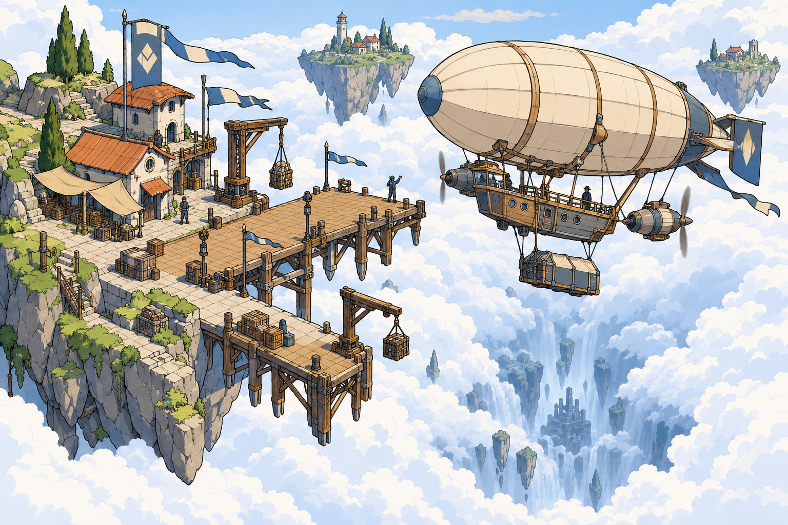
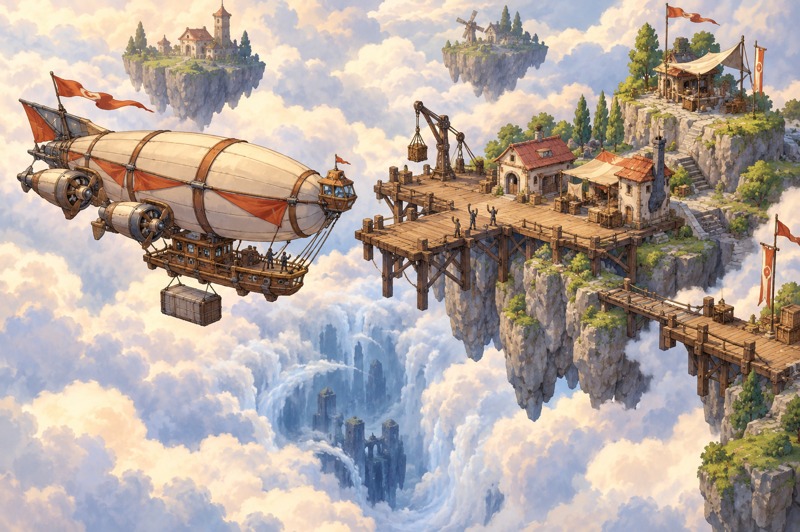
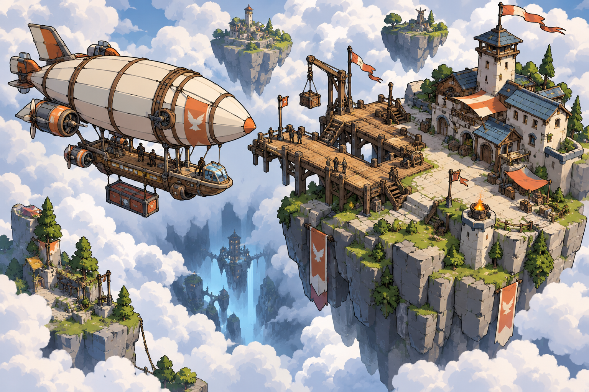
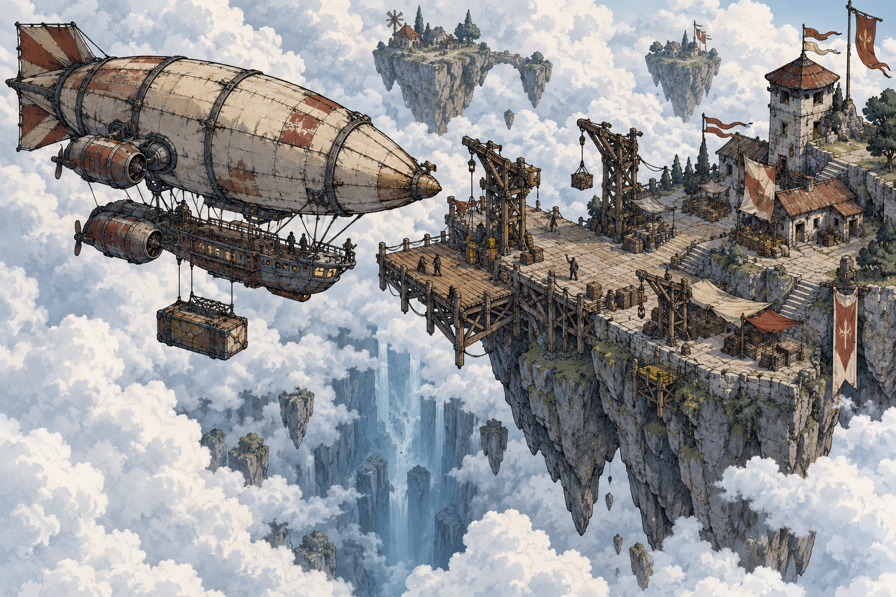

# The Isle — Grafikstil: Gemaltes Abenteuer

Stand: 11. Oktober 2026. **Gewählt: B — Gemaltes Abenteuer.** Die Auswahl wurde vom Auftraggeber ausdrücklich getroffen.

Vier gezeichnete Vorschläge untersuchen unterschiedliche Ausprägungen des gewünschten isometrischen Comicstils. **B bildet die visuelle Referenz für die weitere Entwicklung.** A, C und D bleiben als frühere Alternativen dokumentiert. Alle zeigen dieselbe Art von Szene: einen modularen Zeppelin, einen Inselhafen über den Wolken, weitere schwebende Inseln und einen Blick in eine tiefere Ebene.

Die Bilder sind Concept Art zur Stilfindung. Sie legen noch keine konkreten Spielassets, endgültige Kameraparameter oder technische Umsetzung fest. Die Motive sind vergleichbar; Positionen und Detailformen unterscheiden sich zwischen den unabhängig erzeugten Bildern.

## A — Klare Comic-Linien

Saubere Konturen, klar getrennte Farbflächen, zurückhaltende Schatten und ein heller Abenteuercharakter. Die technische Konstruktion des Schiffs lässt sich gut ablesen.

**Besonders passend für:** Lesbare Module, Waren und Häfen; einen ruhigen Bildaufbau mit vielen sichtbaren Spielobjekten.

**Beim nächsten Entwurf prüfen:** Ob die kleinen Details auch in der tatsächlichen Spielansicht lesbar bleiben. Gefahr und tiefe Ebenen sollten innerhalb derselben Bildsprache eine eigene Stimmung bekommen.

## B — Gemaltes Abenteuer · ausgewählt

Weiche, gemalte Wolken, warme Beleuchtung und sanfte Materialtexturen. Die Welt wirkt märchenhaft und lädt zum Entdecken ein.

**Besonders passend für:** Erkundung, Wetterstimmungen und die Wirkung einer großen, geheimnisvollen Welt.

**Beim nächsten Entwurf prüfen:** Schiff und interaktive Orte müssen sich auch bei Nebel, Gegenlicht und dichter Bewölkung klar von der Umgebung abheben.

## C — Cel-Shading-Diorama

Räumliche, vereinfachte Formen mit deutlichen Konturen und abgestuften Schatten. Schiff und Hafen wirken wie ein dreidimensionales Comic-Diorama.

**Besonders passend für:** Sichtbaren modularen Ausbau, räumliche Inseln und eine spätere Erprobung mit stilisierten 3D-Modellen.

**Beim nächsten Entwurf prüfen:** Der gewünschte Kontur- und Schattenstil muss an einem echten Modell und in Bewegung beurteilt werden. Die Illustration ist kein Nachweis für eine bereits funktionierende 3D-Darstellung.

## D — Rauer Entdecker-Comic

Kräftige Tuschelinien, vereinzelte Schraffuren, geflickte Stoffe und verwitterte Materialien. Gedämpfte Farben vermitteln lange Reisen, Gewicht und eine anspruchsvolle Welt.

**Besonders passend für:** Piraten, alte Technik, Schiffsschäden und gefährliche Regionen.

**Beim nächsten Entwurf prüfen:** Wie viel Oberflächendetail die Spielansicht verträgt und wie freundliche Häfen sowie sichere Regionen innerhalb dieser Stilrichtung wirken.

## Auswahlkriterien

1. Welche Stimmung passt zum gewünschten Abenteuer?
2. Bleibt der Zeppelin in Wolken und vor Inseln sofort erkennbar?
3. Lassen sich Motoren, Frachträume, Waffen und Schäden unterscheiden?
4. Wie wirkt derselbe Stil in Sonnenlicht, im Sturm und in der Wolkentiefe?
5. Ist die Darstellung in kleiner Spielansicht und in Bewegung lesbar?
6. Wie gut lassen sich neue Module und Inseltypen konsistent ergänzen?

Die Weiterentwicklung richtet sich nach B. Eine Mischung mit anderen Richtungen ist bisher nicht beschlossen. In der Spielkamera werden vor allem malerische Wolken, warme Lichtstimmung, weiche Materialtexturen und ausreichend lesbare Objektformen geprüft.

## Nächster Schritt

Als nächster Vorschlag entstehen gezielte Referenzen im gewählten Stil: ein Startzeppelin mit mehreren Modulen, ein Hafen, eine gefährliche Region und ein Wolkenübergang. Daraus wird ein kleiner Test in der Spielkamera abgeleitet. Den spielerischen Umfang beschreibt die [erste Demo](erste-demo.md).

Meshy ist ein möglicher nächster Baustein für eine 3D-Probe des ausgewählten Zeppelins. In dieser Runde wurde kein Meshy-Modell erzeugt. Für die geprüfte Meshy-CLI ist Node.js ab 22.12 erforderlich; die aktuelle lokale Laufzeit meldete Version 18.14.2.

## Erzeugung und Originaldateien

Die vier Illustrationen wurden mit dem eingebauten Werkzeug **Imagegen** erzeugt. Die vollständigen Einzelprompts und Ausgabeparameter liegen in [design/prompts.json](design/prompts.json).

- [A — Originalbild](design/a-klare-comic-linien.png)
- [B — Originalbild](design/b-gemaltes-abenteuer.png)
- [C — Originalbild](design/c-cel-shading-diorama.png)
- [D — Originalbild](design/d-rauer-entdecker-comic.png)
